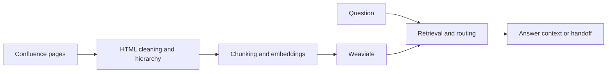

# Knowledge Retrieval Assistant

**Confluence ingestion and Weaviate-backed retrieval components with document hierarchy, FAQ integration, bot handlers and explicit assistant handoff paths.**

A knowledge assistant must preserve the relationship between source pages and retrieval context. This implementation separates source ingestion, HTML cleaning, storage, retrieval helpers and conversation routing so that a failure can be traced to a specific boundary instead of attributed to the LLM as a whole.

## Architecture and data flow



## Implementation decisions

1. Confluence access and upload are separate from bot handlers and agent orchestration. Source metadata and hierarchical page relationships are handled in the integration layer.

2. The existing HTML-cleaning function is extracted into a lightweight module used by the uploader and tests. It can be checked without opening a vector database or creating provider clients.

3. Weaviate retrieval and FAQ helpers form a distinct search boundary. Their existence does not establish retrieval recall or answer grounding on an unseen question set.

4. Handoff utilities are visible as a separate conversation-routing concern. End-to-end permission enforcement must be checked along the actual retrieval path.

5. Corporate documents, tenant endpoints, FAQ exports and account credentials are excluded. The reproducible example uses a generated knowledge page.

6. The runtime requirements describe an older integration stack. Provider/Weaviate SDK compatibility must be resolved in a dedicated environment rather than inferred from utility-test success.

## Source navigation

| Module | Responsibility |
| --- | --- |
| `integrations/confluence_api/weaviate_upload.py` | Uploader, hierarchy and Weaviate schema |
| `integrations/confluence_api/text_utils.py` | HTML cleaning and date helpers |
| `ai/mas/utils/graph_base.py` | Retrieval and FAQ helpers |
| `ai/mas/utils/handoffs.py` | Conversation handoff paths |
| `bot` | Bot event handlers |
| `data/sync_faq_table.py` | FAQ synchronization boundary |

## Reproducible component checks

The minimal checks use Python 3.11/3.12 and `requirements-checks.txt`. They are independent of live accounts, paid APIs and GPU inference. They exercise the specific boundary described below; they are not a measurement of the complete application's model quality.

Linux/macOS, from the repository root:

```bash
python3.11 -m venv .venv
.venv/bin/python -m pip install -r requirements-checks.txt
.venv/bin/python offline_demo.py
.venv/bin/python -m unittest discover -s tests/offline -v
.venv/bin/python scripts/check_source.py
```

Windows PowerShell, from the repository root:

```powershell
py -3.11 -m venv .venv
& ./.venv/Scripts/python.exe -m pip install -r requirements-checks.txt
& ./.venv/Scripts/python.exe offline_demo.py
& ./.venv/Scripts/python.exe -m unittest discover -s tests/offline -v
& ./.venv/Scripts/python.exe scripts/check_source.py
```

### What the replay actually verifies

The existing cleaner processes a generated HTML page, removes script/style/macro content and preserves useful headings, text and list items. This test does not create embeddings, execute retrieval, call an LLM or verify an enterprise ACL policy.

The recorded example output is in [docs/offline-demo-output.json](docs/offline-demo-output.json). CI checks the minimal suite separately from a Gitleaks secret scan. Source compilation verifies syntax; it does not instantiate every runtime integration.

## Full runtime and configuration

Docker Compose defines Weaviate, QnA and reranker services. Review the runtime requirements and supply local Confluence/Weaviate/provider settings before connecting an approved corpus. Run ingestion as a module from the root with `python -m integrations.confluence_api.weaviate_upload`. Document and FAQ inputs must be supplied separately by their authorized owner.

Runtime dependencies and configuration notes are documented in [docs/runtime.md](docs/runtime.md). Minimal and full-runtime environments are intentionally separate. Filled local settings, credentials, production exports and original Git history are outside the source export. Configuration examples describe shape and environment references; they are not a working customer account.

## Evaluation protocol

Prepare source-linked questions and expected evidence from an authorized corpus. Measure retrieval Recall@K, evidence/citation correctness, unsupported answers, answer abstention and latency. Include document updates, stale chunks, ambiguous questions and permission changes. Access checks at a bot handler do not prove ACL filtering throughout the storage/retrieval path.

## Current boundaries

- No independent retrieval or grounded-answer benchmark is included.
- End-to-end ACL behavior needs explicit integration tests.
- The minimal demonstration exercises ingestion cleaning only.

This repository presents the reviewed, anonymized source and the reproducible component checks described above. Private account configuration, customer identities, production documents, recordings and original deployment settings are excluded. Full application-level evaluation remains separate from the offline checks.

## Provenance and dependencies

The source export belongs to the author's local project family; technical component boundaries are recorded in [docs/source-provenance.json](docs/source-provenance.json). Third-party libraries, pretrained models and adapters retain their own licenses and attribution; see [THIRD_PARTY.md](THIRD_PARTY.md). No new permissive license is assigned by this documentation update.

Where present, [docs/original-guide.md](docs/original-guide.md) preserves the implementation guide with neutralized service names. It is reference material and must be read together with the current runtime and validation boundaries above. It is not a claim of production readiness.

For explicit CSV/Excel selection, portable sample data and layout overrides, see the [FAQ ingestion guide](docs/faq-ingestion.md).
